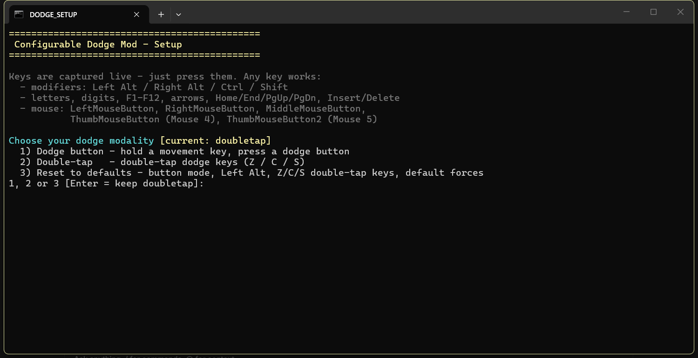
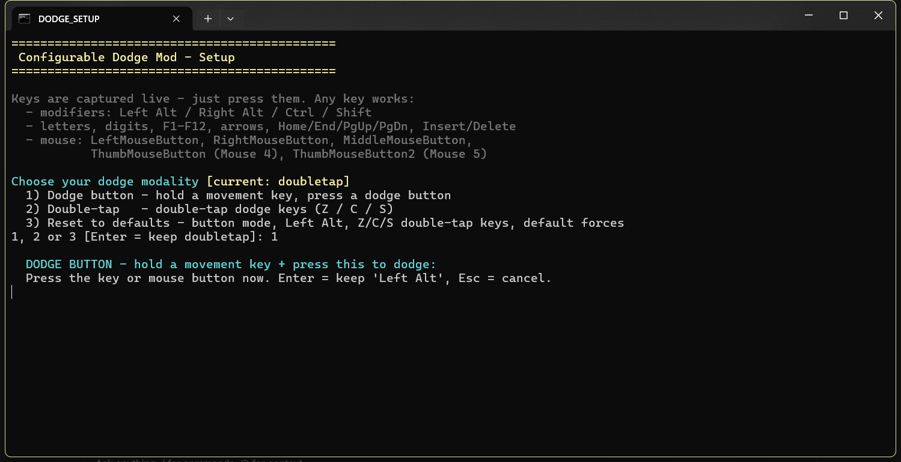
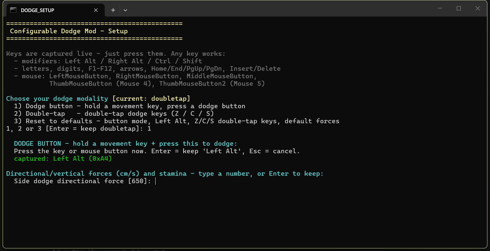

# Configurable Dodge Mod for S.T.A.L.K.E.R. 2

Hold a movement key and press your dodge button (default **Left Alt**), or
double-tap your dodge keys, and Skif dodges left / right / back relative to the
camera. Each dodge costs stamina. Every key and force value is configurable.

## Demo

## How key detection works

The mod reads the configured keys directly from the game's own input system
(`PlayerController:IsInputKeyDown`), about every 10 ms. Presses are
edge-detected and the double-tap timing runs in Lua. Nothing external runs:
no helper process, no console window, no named pipe.

This works for any key the engine knows: letters, digits, F1-F12, arrows,
numpad, modifiers (Left Alt / Ctrl / Shift) and mouse buttons. F13-F24 have
no engine key and cannot be used.

## Energy drink interaction

Vanilla energy drinks briefly stop stamina drain after drinking. The mod
notices the drink through the game's own energetic-overuse value - the stat
system reads it, and the mod listens to that read (a sharp rise means a drink
was just consumed; nothing is polled). Dodges during the same short window are
free, matching the game's behaviour. Default window: 4.5 s.
Set `EnergyDrinkEffect=0` to ignore it.

## Install

### Full package (UE4SS not installed)

1. Copy the contents of the zip into
   `Stalker2\Binaries\Win64\` - the folder containing
   `Stalker2-Win64-Shipping.exe`.
2. Launch the game. Done - the package includes a UE4SS runtime with the
   update 2.x compatibility fix.

### Mod-only package (UE4SS already installed)

1. Copy the `ConfigurableDodgeMod` folder into
   `Stalker2\Binaries\Win64\ue4ss\Mods\`.
2. Add `ConfigurableDodgeMod : 1` to `ue4ss\Mods\mods.txt`.
3. Launch the game.

Default controls: hold **A/D/S** and press **Left Alt** to dodge.

## Use

- Hold a movement key and press the dodge button. A/D/S dodge left / right /
  back; forward-only movement does nothing.
- In double-tap mode, double-tap the configured keys (Z / C / S by default).
- 15 stamina per dodge (vanilla jump). Low stamina and open menus/dialogs block
  dodges.
- Right after an energy drink, dodges are free for the same short window in
  which the game itself stops stamina drain (see below).

## Configure

Run **`Setup.bat`** in the mod folder:

- choose button or double-tap mode
- press a key to bind it - any key works, including Left Alt/Ctrl/Shift and
  mouse buttons; it is stored as name plus hex (e.g. `0x58   ; X`)
- set forces and stamina cost, toggle the energy drink interaction and its
  free-dodge window, or press **3** to reset everything to defaults

Or edit **`ConfigurableDodgeMod.ini`** directly:

| Key | Meaning | Default |
| --- | --- | --- |
| `Modality` | `button` or `doubletap` | `button` |
| `ButtonKey` | dodge button (name, VK hex or mouse button) | `Left Alt` |
| `DoubleTapLeft/Right/Back` | double-tap keys | `Z` / `C` / `S` |
| `DoubleTapWindow` | max seconds between taps | `0.155` |
| `SideHorizontal/SideVertical` | side dodge force (cm/s) | `650` / `500` |
| `BackHorizontal/BackVertical` | back dodge force (cm/s) | `900` / `200` |
| `StaminaCost` | stamina per dodge | `15` |
| `EnergyDrinkEffect` | free dodges during the drink's no-drain window (`1` / `0`) | `1` |
| `EnergyDrinkFreeSeconds` | length of that window (seconds) | `4.5` |
| `EnergyDrinkOveruseJump` | overuse rise that registers a drink (advanced) | `50` |

Changes apply live within ~2 seconds - no restart.

## Requirements

| Dependency | Version |
| --- | --- |
| S.T.A.L.K.E.R. 2: Heart of Chornobyl | update 2.0+ |
| UE4SS | experimental `v3.0.1-1028-gd7e7826d` |
| RE-UE4SS Compatibility Fix (Nexus 2341) | v1.2 - included in the `_full` package |

## Credits

- Dodge concept: **rbwadle** (Nexus 1243) - the original pak mod cannot load on
  update 2.0
- **UE4SS** (RE-UE4SS, MIT) and the community compatibility fix (Nexus 2341)
