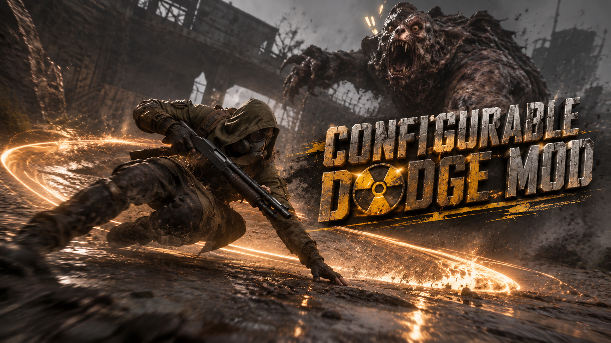
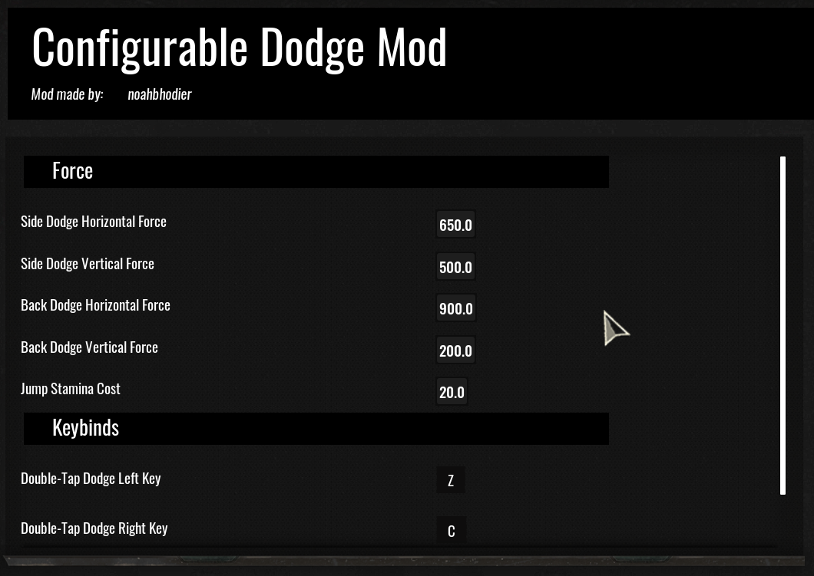
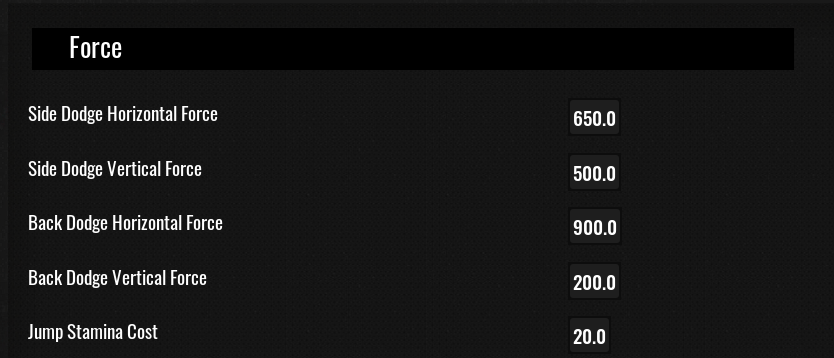
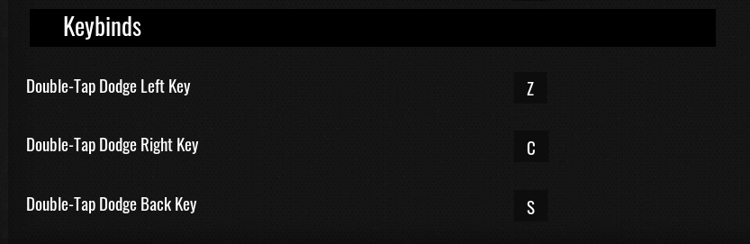

# Configurable Dodge Mod for S.T.A.L.K.E.R. 2

Double-tap **Z** (left), **C** (right) or **S** (back) and Skif hops out of the
way. Values (dodge strengths, stamina cost, keys) are configurable in the
Mod Configuration Menu.

## Demo

## Requirements

| Dependency | Version / ID |
| --- | --- |
| S.T.A.L.K.E.R. 2: Heart of Chornobyl | update 2.0+ (Steam) |
| UE4SS | experimental build `v3.0.1-1028-gd7e7826d` (GitHub `UE4SS-RE/RE-UE4SS`, `experimental` tag) |
| RE-UE4SS Compatibility Fix for Update 2.0 (UE5.5) | Nexus Mods ID 2341, v1.2 (ship game-specific `GUObjectArray`/`FName::ToString` signatures + patched `UE4SS.dll`; the `_full` package already includes it) |
| Mod Configuration Menu | Nexus Mods ID 2225, v2.0 (optional — mod works without it at default values) |

## Install

1. Copy the `ConfigurableDodgeMod` folder to `Stalker2\Binaries\Win64\ue4ss\Mods\`
2. Add `ConfigurableDodgeMod : 1` to `ue4ss\Mods\mods.txt`
3. Launch. Hold a movement key and press **Mouse 5** to dodge (double-tap `Z` / `C` / `S` also works).

## Configure

Press your MCM key in game → open **Configurable Dodge Mod**.
Settings apply live while the game runs.

- **Dodge Button Key**: the button pressed together with a movement key
  (default `Mouse 5`). The capture field accepts mouse buttons — side
  buttons are the recommended dodge buttons, since keyboard-button delivery
  depends on UE4SS's input hook and can be unreliable after loading a world.
- Dodge strengths, stamina cost, and the double-tap keys are all in MCM too.

## Notes

- Each dodge costs 20 SP (vanilla jump); dodging is blocked at low stamina
- Dodging is disabled while the game is in a menu/dialog (stash, conversations)
- If MCM settings don't appear at first, save the game once and load that save

## Credits

- Dodge concept: **rbwadle** (Nexus 1243) — the original pak mod predates
  update 2.0's engine and cannot load on it; this is a script-side rebuild
- **UE4SS** (RE-UE4SS, MIT) and the community compatibility fix (Nexus 2341)
- **Mod Configuration Menu** by Kyne / ZunaSW (Nexus 2225)

